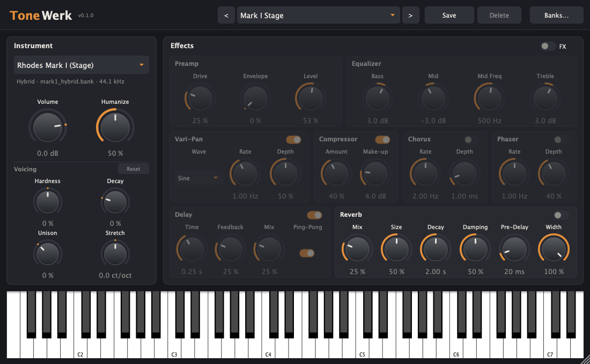

# ToneWerk



The hybrid instruments of [pmpiano](https://github.com/Michi71/pmpiano) as a plugin and standalone app: Rhodes Mark I/II,
Suitcase, MK8 (physical model), Wurlitzer 200A, Clavinet D6, Pianet T, the grands (SGP, Steinway, Grandpa's) and the Yamaha
CP80, plus the MK8 effect chain. Built with [JUCE](https://juce.com) on the [Pamplejuce](https://github.com/sudara/pamplejuce)
template for **macOS, Linux and Windows** as **VST3, AU (macOS), CLAP and Standalone**.

## Repository layout

| Folder | Contents |
|---|---|
| `engine/` | the pmpiano engine core (physical modelling and hybrid voices); version and changes in [engine/UPSTREAM.md](engine/UPSTREAM.md) |
| `banks/` | the nine hybrid banks (**Git LFS**, ~160 MB); origin and licences in [docs/BANKS.md](docs/BANKS.md) |
| `source/` | the plugin: processor, loader, resampler, presets, user interface |
| `tests/` | Catch2 tests (`Tests`) |
| `JUCE/`, `cmake/`, `modules/clap-juce-extensions/` | submodules (JUCE `develop`, Pamplejuce CMake helpers, CLAP) |

## Building

```bash
git clone --recursive https://github.com/Michi71/ToneWerk.git
cd ToneWerk
git lfs pull
cmake -B Builds -G Ninja -DCMAKE_BUILD_TYPE=Release
cmake --build Builds
ctest --test-dir Builds --output-on-failure
```

Requirements: CMake ≥ 3.25, Ninja, a C++20 compiler (Xcode/Clang, clang-cl or MSVC, GCC/Clang on Linux) and, on Linux, the
JUCE dependencies (`libasound2-dev libjack-jackd2-dev libx11-dev libxinerama-dev libxext-dev libxrandr-dev libxcursor-dev
libfreetype6-dev libfontconfig1-dev`). The results are in `Builds/ToneWerk_artefacts/Release/`; on the Mac the build copies
VST3, AU and CLAP to `~/Library/Audio/Plug-Ins/`.

CMake options:

- `TONEWERK_DEV_BANKS` (on): the build finds the banks in its own `banks/` folder. Turn it off for a distribution.
- `TONEWERK_BUNDLE_BANKS` (off): copies `banks/*.bank` into the plugin bundles (`Contents/Resources/banks`) and next to the
  standalone app.
- `TONEWERK_FLOAT` (off): the engine computes in single precision (`PMP_FLOAT`).

## Banks

A hybrid instrument needs its bank. The plugin searches in this order:

1. the folder chosen in the plugin (**Banks… → Choose folder…**, shared by all instances),
2. `$TONEWERK_BANKS`,
3. `banks/` inside the bundle (`Contents/Resources/banks`) or next to the app,
4. the user folder: `~/Library/Application Support/ToneWerk/banks` (macOS), `%APPDATA%\ToneWerk\banks` (Windows),
   `~/.config/ToneWerk/banks` (Linux),
5. the system folder: `/Library/Application Support/ToneWerk/banks`, `C:\ProgramData\ToneWerk\banks`, `/usr/local/share/ToneWerk/banks`,
6. in a development build, `banks/` of the source tree.

Without its bank, Mark I, Mark II, Suitcase, Wurlitzer and Clavinet play their physical model; the grands, the Pianet and the
CP80 have none and stay silent. The status line below the instrument choice tells what plays.

## Usage

- **Instrument**: the presets of the engine. Switching loads the bank in the background; the previous instrument fades out in 30 ms.
- **Volume** (−48 … +12 dB) after the effect chain, followed by a peak limiter (attack 0.1 ms, release 120 ms, no lookahead)
  and the engine's soft clip as the last safeguard: full chords are turned down instead of distorted. The clavinet and the
  Pianet are trimmed by −5 and −6.5 dB to the level of the other instruments.
- **Humanize** (0–100 %, default 50 %): every strike scatters a little, so no two notes are bit for bit the same. The velocity
  is multiplied by a random factor exp(σ g); 50 % is the physical presets' hammer-speed scatter (`human.speed` 0.05) carried
  over to the velocity (σ 0.038 of ln velocity), 100 % twice that. Level and, through the layer blend, timbre move: at 100 %
  the level of repeated strikes scatters by about 1 dB. Applies to every instrument; the physical model is built without its
  own speed scatter. At 0 % the hybrid voices repeat a strike bit for bit (at the bank's rate).
- **Voicing** on the poles and layers of the bank (pmpiano README "Voicing"): hardness, decay, unison, stretch. Every change
  rebuilds the instrument (after 250 ms without further changes); sounding notes stop. The settings stay when the instrument
  changes, and extremes carry over (hardness −200 takes up to 6 dB off the highs, decay +300 lets chords build up into the soft
  clip): **Reset** sets all four back to the instrument as calibrated.
- **Effects**: the MK8 chain in the units of the Rhodes V8 Pro – preamp (drive, envelope, level), equalizer, Vari-Pan,
  compressor, chorus, phaser, delay. The **FX** switch bypasses the whole chain; like the reverb switch it cross-fades over
  20 ms, so switching while playing does not click.
- **Reverb** at the end, on its own switch (independent of **FX**, so the grands get a room without the MK8 preamp): mix, size,
  decay (RT60 0.3–10 s), damping (how much faster the highs die away), pre-delay (0–200 ms), width. The grand presets have it on;
  Steinway and Grandpa's with less, their recordings carry some room already.
- **Presets**: factory and user presets in one list; **Save** stores the current settings as
  `~/Documents/ToneWerk/Presets/<name>.twpreset` (XML), **Delete** moves a user preset to the trash, `<`/`>` step through the list.
  The host saves the state, including the preset name, with the project.
- **Keyboard**: the engine's 73 keys E1–E7, playable with the mouse; incoming MIDI notes light up.
- MIDI: note on/off with velocity, CC64 (half pedal), CC1 (pickup voicing of the physical model), CC120/123.

## How it works

- The engine runs at **the rate of its bank** (44.1 kHz, the SGP grand 48 kHz; the physical model without a bank 48 kHz). A short
  Kaiser-windowed sinc resampler (`source/Resampler.*`, 48 taps) converts to the host rate; at equal rates it is bypassed. Its only
  delay is the lookahead of 24 input samples (0.54 ms at 44.1 kHz); passband flat to ±0.03 dB up to 18 kHz, 83–97 dB
  signal-to-noise (`tests/ResamplerTests.cpp`). `./Builds/Tests "[.latency]"` measures the time from note-on to the attack for
  every instrument.
- The screenshot above is rendered by a hidden test: `TONEWERK_SNAPSHOT=$PWD/docs/images/tonewerk.png ./Builds/Tests "[.snapshot]"`.
- A loader thread builds instruments (reads the bank, prepares the engine) and hands them over through an atomic pointer; the
  audio thread adopts them, fades the old one out and hands it back for deletion. Nothing is allocated or freed on the audio thread.
- The effect chain (`pmp::Mk8Effects`) runs in the plugin at the host rate; the engine itself runs with `fx.on=0` and without
  its soft clip.
- The reverb (`source/Reverb.*`) is a feedback delay network: pre-delay, early reflections, four allpass diffusers per channel,
  eight delay lines mixed by a Hadamard matrix, each with a one-pole absorption filter set from the RT60 at low frequencies and
  at Nyquist. Slow modulation of the line lengths (read through a first-order allpass, which keeps the RT60 exact) prevents
  metallic ringing. Measured in `tests/ReverbTests.cpp`: RT60 within 8 % of the setting for every size, stable at the extremes,
  bit-transparent at mix 0; about 0.3 % of one core.
- The engine is built without fast math (its own target `pmpcore`); the template's default `-Ofast` is deliberately not used.

## CI

`.github/workflows/build.yml` builds and tests on macOS (universal), Linux and Windows, validates the VST3 with pluginval
(strictness 10) and uploads one zip per platform. The CI does **not** check out the banks (LFS quota of a private repository);
its tests run with the physical models. A `v*` tag creates a release with the three zips and `ToneWerk-Banks.zip`. The builds
are not signed: macOS reports them as unidentified (`xattr -dr com.apple.quarantine <plugin>`), Windows SmartScreen likewise.

## Licence

GPL-3.0-or-later like pmpiano (`LICENSE`). JUCE is licensed under the AGPLv3 or the JUCE licence; a distributed binary is
therefore subject to the terms of the AGPLv3. The banks are covered by the licences of the free libraries they are built from
([docs/BANKS.md](docs/BANKS.md)).
