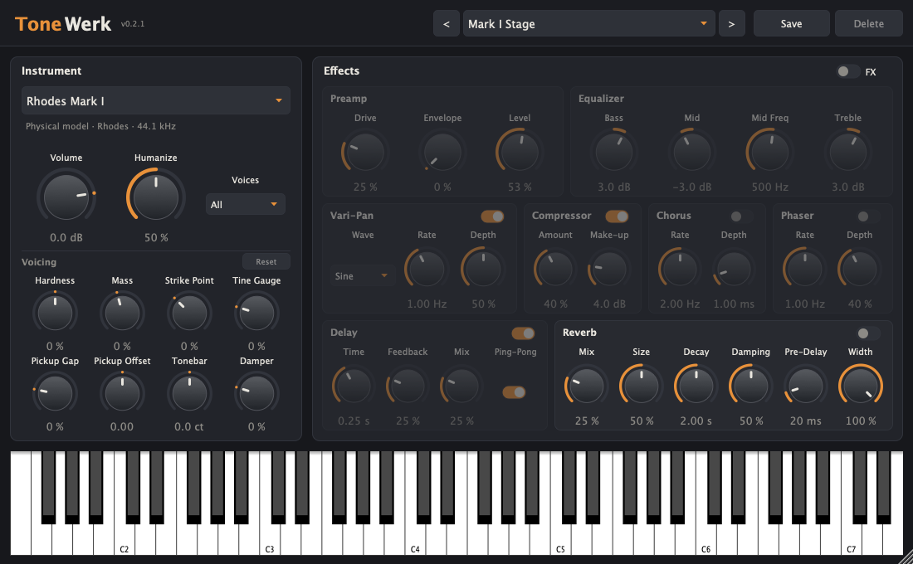

A maintenance release: a tuning fix for the Splendid Grand, quieter attacks on three Rhodes models and a preset level.

▶ [Watch the video](https://youtu.be/U0xUk3iMI5s): the factory presets one after the other, three minutes.

## What is new

- **Splendid Grand Piano:** B♭4 was out of tune: its fundamental was split in two and the tail ended about two thirds of a
  semitone flat. The bank is rebuilt from recordings transposed to each key's pitch, which also removes a smaller detune
  between the velocity layers of a few other keys.
- **Rhodes Mark I, Mark V, Mark 7:** a click in the attack of some keys in the upper middle range is gone (the upper tonebar
  mode is muted there).
- **Factory preset Clavinet Funk:** 4 dB quieter; it reached the soft clip even when played softly.
- **Demo:** `demo/ToneWerk-Demo.mid` in the repository walks through the factory presets (the MIDI file of the video).

Projects and user presets of 0.2.0 load unchanged. For everything that came with 0.2.0 (the instruments, voicing, MIDI
learn) see the [notes of 0.2.0](https://github.com/Michi71/ToneWerk/releases/tag/v0.2.0).

## Downloads

| File | Contents |
|---|---|
| `ToneWerk-0.2.1-macOS.zip` | VST3, AU, CLAP, Standalone – universal (Apple Silicon and Intel), macOS 11+ |
| `ToneWerk-0.2.1-Windows.zip` | VST3, CLAP, Standalone (x64) |
| `ToneWerk-0.2.1-Linux.zip` | VST3, CLAP, Standalone (x64) |

Each zip contains the licence (`LICENSE.txt`) and the credits of the recordings the hybrid voices are built from
(`CREDITS.md`).

## Installation

Copy the plugin formats to the usual folders: macOS `~/Library/Audio/Plug-Ins/VST3`, `…/Components`, `…/CLAP`; Windows
`C:\Program Files\Common Files\VST3` and `…\CLAP`; Linux `~/.vst3`, `~/.clap`. The standalone app runs from anywhere.

## Known limitations

- The builds are **not signed**. macOS: `xattr -dr com.apple.quarantine <plugin or app>`; Windows SmartScreen asks for
  confirmation.
- Changing a voicing control rebuilds the instrument; sounding notes stop.

## Licence

GPL-3.0-or-later; JUCE under the AGPLv3. The banks of the hybrid voices are covered by the licences of their recordings
(public domain, CC0, CC BY 3.0; `CREDITS.md`).
