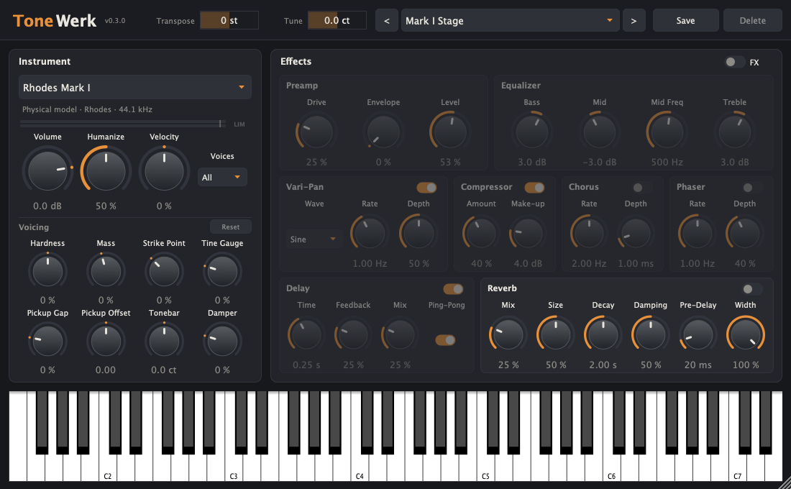

Seven new factory presets: the Rhodes sounds of seven classic intros.

▶ [Watch the video](https://youtu.be/U0xUk3iMI5s): the first fourteen factory presets one after the other, three minutes (recorded with 0.2.1).

## What is new

This release adds presets and has no new controls. The instruments sound as in 0.3.2.

- **Seven Rhodes intro presets** at the end of the preset list (MIDI programs 29 to 35):

  | Preset | Instrument | Effects |
  |---|---|---|
  | Just The 2 Of Us | Mark I | Vari-Pan, phaser, reverb |
  | 100 Ways | Mark I | phaser |
  | How Deep Is Your Love | Mark I | Vari-Pan, phaser, reverb |
  | You Are The Sunshine Of My Life | Mark I | Vari-Pan |
  | Riders On The Storm | Mark V | Vari-Pan, a little drive |
  | Just The Way You Are | Mark 7 | Vari-Pan, phaser, a little drive |
  | Livin For The City | Sparkle Top | Vari-Pan, a little drive |

  Each was fitted to a reference recording of its intro: the pickup and hammer voicing, the tone controls, the depth of
  the Vari-Pan and the level. The fit was measured (spectrum from 100 Hz to 4 kHz, left/right movement, loudness), not
  tuned by ear, so take them as starting points. Above 5 kHz the presets are brighter than the references, "Just The
  Way You Are" most of all: turn **Treble** down if it is too sharp.

## What changes for existing projects

Projects and user presets of 0.3.x and 0.2.x load unchanged. No control, no instrument and no existing preset changes;
the factory presets that were there keep their place in the list and their MIDI program numbers.

## Downloads

| File | Contents |
|---|---|
| `ToneWerk-0.3.3-macOS.zip` | VST3, AU, CLAP, Standalone – universal (Apple Silicon and Intel), macOS 11+ |
| `ToneWerk-0.3.3-Windows.zip` | VST3, CLAP, Standalone (x64) |
| `ToneWerk-0.3.3-Linux.zip` | VST3, CLAP, Standalone (x64) |

Each zip contains the licence (`LICENSE.txt`) and the credits of the recordings the hybrid voices are built from
(`CREDITS.md`).

## Installation

Copy the plugin formats to the usual folders: macOS `~/Library/Audio/Plug-Ins/VST3`, `…/Components`, `…/CLAP`; Windows
`C:\Program Files\Common Files\VST3` and `…\CLAP`; Linux `~/.vst3`, `~/.clap`. The standalone app runs from anywhere.

## Known limitations

- The builds are **not signed**. macOS: `xattr -dr com.apple.quarantine <plugin or app>`; Windows SmartScreen asks for
  confirmation.
- While notes ring out after a voicing change, two instruments compute. A further change in that time fades the ringing
  notes out, and switching the instrument fades as before.
- A change of **Tune** rebuilds the instrument like a voicing control, and the decay times change with the pitch (by 6 %
  at most).

## Licence

GPL-3.0-or-later; JUCE under the AGPLv3. The banks of the hybrid voices are covered by the licences of their recordings
(public domain, CC0, CC BY 3.0; `CREDITS.md`).
